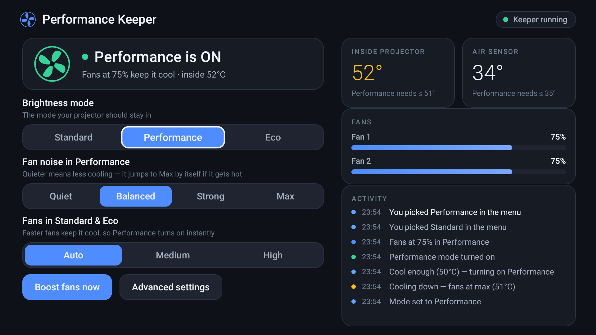
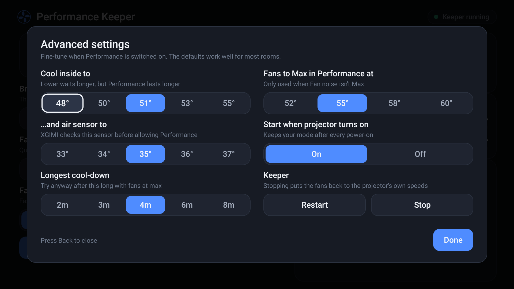
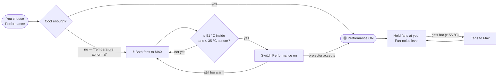

<p align="center">
  
</p>

<p align="center">
  <a href="https://github.com/ratnajitswain/perfermance-keeper-for-xgimi/releases/latest"></a>
  <a href="https://github.com/ratnajitswain/perfermance-keeper-for-xgimi/releases"></a>
  
  
  <a href="LICENSE"></a>
</p>

<p align="center">
  <a href="https://github.com/ratnajitswain/perfermance-keeper-for-xgimi/releases/latest/download/PerformanceKeeper.apk"><b>⬇&nbsp; Download PerformanceKeeper.apk</b></a>
  &nbsp;·&nbsp; <a href="#-install-in-3-steps">Install</a>
  &nbsp;·&nbsp; <a href="#-using-it">Usage</a>
  &nbsp;·&nbsp; <a href="#-faq">FAQ</a>
  &nbsp;·&nbsp; <a href="#-troubleshooting">Troubleshooting</a>
</p>

---

## The problem

On XGIMI projectors, **Picture → Brightness Mode → Performance** often won't stay on. You pick it, and the
projector shows:

> **Temperature abnormal. Switched to default mode**

It works one day and not the next. The cause: in **Standard** mode the projector runs its fans slowly (one fan at
about **25 %**). It slowly heats up, and once the light engine is warm the firmware refuses Performance.

## The fix

**Performance Keeper** is a small app that runs on the projector. When you ask for Performance and it's too warm, it
**runs both fans at full speed until the projector cools down**, then **switches Performance on by itself**.
It keeps it on, and it remembers your choice after every power-on.

On the tested projector it cools from **61 °C to 51 °C in about 90 seconds**, then Performance turns on.
You don't need a computer, root access or any extra hardware.

## 📸 Screenshots

<p align="center">
  
  <br><sub><b>Main screen:</b> current status in plain words, live temperatures, fan speeds and what the app just did.</sub>
</p>

<p align="center">
  
  <br><sub><b>Advanced settings:</b> cooling targets, start on boot, restart/stop. The defaults suit most rooms.</sub>
</p>

## ✨ Features

| | |
|---|---|
| 🌀 **Cools first, then switches on** | Runs the fans at max until it's cool enough, then turns Performance on automatically. |
| 🔁 **Keeps your mode** | Remembers Performance / Standard / Eco, even after the projector is switched off and on. |
| 🔇 **Fan noise control** | Quiet · Balanced · Strong · Max in Performance. If it gets hot, it goes to Max on its own. |
| ❄️ **Cooler Standard mode** *(optional)* | Run the fans a little faster in Standard so Performance can turn on instantly. |
| 📊 **Live status** | Inside temperature, air-sensor temperature, both fan speeds, and a plain-language activity feed. |
| 🎮 **Made for the remote** | Big, clear 10-foot UI. Everything works with the D-pad. |
| 🛡️ **Keeps XGIMI's protection** | Never overrides the projector's own overheat protection (see [Safety](#-safety)). |
| 🔋 **Light on resources** | 70 KB app. The background helper checks the projector every 15 s and is otherwise idle. |

---

## 🚀 Install in 3 steps

### What you need
- An **XGIMI projector with Google TV / Android TV 11**. See [Compatibility](#-compatibility).
- About 5 minutes.

### Step 1: Turn on USB debugging (one time)

The app uses the projector's built-in **debug service** to control the fans. It connects only to the projector
itself (`127.0.0.1`), never to the internet.

1. **Settings → System → About**, then click **Android TV OS build** **7 times** until you see *"You are now a developer"*.
2. Go back to **Settings → System → Developer options** and turn on **USB debugging**.

### Step 2: Install the app (pick one)

<details open>
<summary><b>Option A: On the projector with the free “Downloader” app (no computer)</b></summary>

1. On the projector, install **Downloader** (by AFTVnews) from the Google Play Store.
2. Allow it to install apps: **Settings → Apps → Security & restrictions → Unknown sources → Downloader → On**.
   The menu wording varies a little between firmware versions.
3. Open Downloader, select the address box and enter:
   ```
   https://github.com/ratnajitswain/perfermance-keeper-for-xgimi/releases/latest/download/PerformanceKeeper.apk
   ```
4. Press **Go**, then **Install**. If Play Protect warns about an unknown developer, choose **Install anyway**.
   The app isn't on the Play Store, which is why the warning appears.
</details>

<details>
<summary><b>Option B: From a computer on the same Wi-Fi (Mac / Windows / Linux)</b></summary>

1. Download [`PerformanceKeeper.apk`](https://github.com/ratnajitswain/perfermance-keeper-for-xgimi/releases/latest/download/PerformanceKeeper.apk)
   and Google's [Android platform-tools](https://developer.android.com/tools/releases/platform-tools) (this gives you `adb`).
2. Find the projector's IP address under **Settings → Network & Internet → (your Wi-Fi)**.
3. Run:
   ```bash
   adb connect 192.168.1.50:5555        # use your projector's IP
   adb install PerformanceKeeper.apk
   ```
   The first time, accept the **“Allow USB debugging?”** prompt on the projector.
</details>

<details>
<summary><b>Option C: USB stick</b></summary>

Copy `PerformanceKeeper.apk` to a USB stick, plug it into the projector, and open it with a file manager app
(for example *X-plore* or *File Commander* from the Play Store). You'll need to allow that app to install unknown apps.
</details>

### Step 3: Open it once and approve

Open **Performance Keeper** from the apps row (blue fan icon). The projector asks:

> **Allow USB debugging?** *The computer's RSA key fingerprint is …*

Tick **“Always allow from this computer”** and press **OK**.

In this case the "computer" is the app itself, asking to use the projector's own debug service. That's it: the app
sets itself up and starts working. You won't see the prompt again.

---

## 🎮 Using it

Open the app and choose **Performance** under **Brightness mode**. Everything else is automatic:

| What you see | What's happening |
|---|---|
| 🟢 **Performance is ON** | Performance is on, and the fans are held at your **Fan noise** level. |
| 🟡 **Cooling down…** | The projector was too warm, so the fans are at max. Performance turns on by itself, usually within 1–2 minutes. |
| 🔴 **Too warm right now** | The projector refused 6 times in a row. The app rests for 20 minutes with normal fans, then tries again. Check the [tips](#performance-never-turns-on). |
| 🔵 **Standard mode** / 🟢 **Eco mode** | Your choice is kept. The fans are left to the projector, unless you picked a minimum below. |

### Settings

| Setting | Options | What it does |
|---|---|---|
| **Brightness mode** | Standard · Performance · Eco | The mode the projector should stay in. You can also change it in XGIMI's own menu; the app notices. |
| **Fan noise in Performance** | Quiet · Balanced · Strong · **Max** | Fan speed while in Performance. Quieter means less cooling, but it goes to Max on its own if it gets too hot. |
| **Fans in Standard & Eco** | **Auto** · Medium · High | *Auto* leaves the fans to the projector. Medium/High keep it cooler, so switching to Performance is instant. |
| **Boost fans now** | — | Runs both fans at max for 2 minutes. |
| **Advanced → Cool inside to** | 48–55 °C (default **51**) | Internal temperature to reach before switching Performance on. |
| **Advanced → …and air sensor to** | 33–37 °C (default **35**) | XGIMI also checks this sensor before allowing Performance. |
| **Advanced → Longest cool-down** | 2–8 min (default **4**) | Try anyway after this long with the fans at max. |
| **Advanced → Fans to Max at** | 52–60 °C (default **55**) | When *Fan noise* isn't Max: the temperature at which the fans go to Max. |
| **Advanced → Start when projector turns on** | **On** · Off | Starts the helper automatically after every power-on. |
| **Advanced → Restart / Stop** | — | *Stop* puts the fans back to the projector's own speeds. |

> 💡 Choose Performance from **Settings → Picture → Brightness Mode** or from this app. The quick-menu shortcut runs
> an extra check and may show *"Please use at 5-25 environmental temperature"*.

---

## ⚙️ How it works



<details>
<summary><b>Technical details</b></summary>

- XGIMI's hardware service `xgimi.hardware.gmpf@1.0::IGmpf` controls the fans and the light engine. The projector's
  SELinux policy lets the debug **shell** user call it, but not normal apps.
- So the app includes a tiny **ADB client** (`AdbClient.java`) and connects to the projector's own debug service on
  `127.0.0.1:5555`. That's the same idea used by tools like Shizuku and LADB.
- Through that connection it installs and starts **`keeper.sh`**, a small shell service running as the shell user. It:
  - reads the real light mode with XGIMI's own tool: `gmpfUnit getDlpLumensMode` (0 = Standard, 18 = Performance, 3 = Eco)
  - switches modes with exactly the call XGIMI's menu makes: `gmpfUnit setDlpLumensMode 18`
  - reads temperatures and sets fan speeds with **`Fanctl`**, a 3 KB Java helper that calls XGIMI's
    `com.xgimi.gmpf.api.TemperatureManager` (`getTemperatureFromSensor`, `setFanRotationRate`)
  - learns the mode you pick in XGIMI's menu by following the system log
- The app starts the helper at boot (`BootReceiver` → `BootService`) and gives you the remote-friendly UI.

```
app/                 Android TV app (no Gradle, plain Java)
  src/…/AdbClient    minimal ADB protocol client (RSA auth, shell)
  src/…/Keeper       install / start / stop / settings / status
  src/…/MainActivity the TV interface   ·   Ui.java = design system
keeper.sh            the on-projector service (state machine)
fanctl/Fanctl.java   temperature + fan helper (runs via app_process)
xgimi-keeper         optional command-line tool for a computer
scripts/             toolchain setup
```
</details>

## 🛡️ Safety

- **XGIMI's overheat protection stays in control.** The projector itself refuses Performance when it's too hot.
  This was checked at 60 °C: the hardware service still answered `HL_HIGHTEMP`. The app only adds cooling and
  never bypasses that check.
- **The fans are only sped up**, never set below the projector's own speeds.
- **Stop or reboot puts everything back.** *Stop* restores the projector's fan speeds, and a reboot without the app
  returns everything to factory behaviour.
- **No root and no system changes.** Uninstalling the app removes everything except the helper files in
  `/data/local/tmp`.
- XGIMI says long periods in Performance can shorten the light source's life. That's true with or without this app.
  Use Performance when you need the brightness.

## ❓ FAQ

**Does it affect Bluetooth, Wi-Fi or my remote?**
No. The app only talks to the projector itself (`127.0.0.1`), so nothing goes over Wi-Fi or Bluetooth.

**Does my computer need to stay on?**
No. After it's installed, everything runs on the projector.

**Will it still work after I switch the projector off and on?**
Yes, if *Start when projector turns on* is **On** (the default). The helper starts by itself once the projector has
finished booting. If it ever shows *Keeper stopped*, opening the app starts it again.

**It's loud.**
Set *Fan noise in Performance* to **Balanced** or **Quiet**. If it gets too hot, it goes to Max on its own.

**Why does it need USB debugging?**
On this projector, fan control is only available to the debug service. The app uses that service locally
(`127.0.0.1`) and approves only itself.

**How do I uninstall?**
In **Advanced settings**, press **Stop** (the fans go back to normal). Then go to **Settings → Apps → Performance Keeper → Uninstall**.
You can turn USB debugging off again afterwards.

## 🧰 Troubleshooting

#### “Can't reach the projector's debug service”
- Make sure **USB debugging** is on (Step 1).
- Open the app again and accept the **Allow USB debugging?** prompt. Tick *Always allow*, or it will ask every time.
- The app needs the projector to accept debug connections on **port 5555**. The tested model does this automatically.
  If yours doesn't, please [open an issue](https://github.com/ratnajitswain/perfermance-keeper-for-xgimi/issues)
  with your model name.

#### Performance never turns on
If the app keeps showing **Too warm right now**:
- Leave **20–30 cm of free space** around the vents. Don't place the projector on a bed, blanket or soft surface.
- **Clean the vents.** Dust makes a big difference.
- If the room is very hot, set *Fans in Standard & Eco* to **Medium** or **High** so the projector stays cooler
  between sessions.
- In **Advanced**, try *Longest cool-down* **6 min**.

#### “Keeper stopped” after power-on
Open the app once. Check that *Advanced → Start when projector turns on* is **On**.

## 📺 Compatibility

| Model | System | Status |
|---|---|---|
| XGIMI **WM03H** (model id H0052) | Google TV · Android 11 · build RTMA.250416.186 | ✅ Tested |
| Other XGIMI Google TV / Android TV 11 models | — | ❔ Probably works; not tested yet. Reports welcome! |

It relies on XGIMI's `gmpfUnit` tool, the `xgimi.hardware.gmpf` service and the debug service listening on port
5555, so other models may differ. Please [report your model](https://github.com/ratnajitswain/perfermance-keeper-for-xgimi/issues),
whether it works or not.

## 💻 Optional: command-line tool

For computer users, `xgimi-keeper` (macOS / Linux) controls the same helper over Wi-Fi:

```bash
XGIMI_IP=192.168.1.50 ./xgimi-keeper install performance   # first time (remembers the IP)
./xgimi-keeper status           # mode, temperatures, fan speeds, recent events
./xgimi-keeper log -f           # follow the activity log
./xgimi-keeper set standard     # or performance / eco
./xgimi-keeper fanhold 190      # fan level in Performance (80–255)
./xgimi-keeper fan probe        # all temperature sensors + fan speeds
```

## 🛠️ Build from source

No Android Studio or Gradle needed. Plain Java and Google's command-line tools:

```bash
./scripts/setup-toolchain.sh    # one time: JDK 17, d8, aapt2, android.jar, adb (~250 MB, into ./toolchain)
./build.sh                      # → dist/PerformanceKeeper.apk
```

The first build creates a signing key at `app/keystore.jks`. Keep it safe: updates must be signed with the same key.

## ⚠️ Disclaimer

This is an **unofficial** community project. It is **not affiliated with, endorsed by or supported by XGIMI**.
"XGIMI" is used only to say which projectors it works with. It uses standard Android developer features and doesn't
modify system files. Use it at your own risk.

## 📄 License

[MIT](LICENSE)
